# CodeCora UI

**One design system, many themes.** Design tokens, mixable themes and accessible
Svelte 5 components on [bits-ui](https://bits-ui.com), built for the CodeCora
product fleet and open to any Svelte app.

[](LICENSE)
[](https://github.com/codecoradev/codecora-ui/releases)
[](https://svelte.dev)

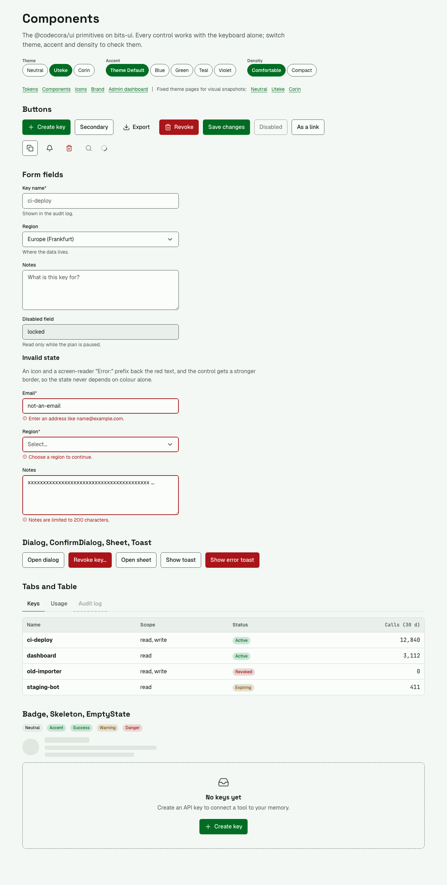

- **Themes you can mix per element.** `data-theme`, `data-accent` and
  `data-density` work on any element, so a dark sidebar can sit next to light
  content without a second stylesheet.
- **Accessible by construction.** Every theme and accent passes WCAG AA in CI
  (the `contrast` theme targets 7:1). Every component works with the keyboard
  alone and at 375 px.
- **No framework lock-in.** Components are plain CSS on semantic `--cc-*`
  tokens. Tailwind 4 and shadcn-svelte are optional bridges, not requirements.
  Works in SvelteKit 2, SvelteKit 3, plain Vite and Tauri.
- **Fix once, reach everywhere.** Shared behaviour lives in the packages;
  product identity lives in themes.

> **Made by the team behind [Uteke Cloud](https://uteke.app)**: long-term
> memory for Claude, ChatGPT and any MCP agent. Add one connector, sign in, and
> your agents remember across conversations and devices. The `uteke` theme in
> this repository comes from it, and `@codecora/memory` is its client.
> [Try it free at uteke.app](https://uteke.app) (open beta, no card).

## Status

`0.4.0`: `@codecora/tokens` and `@codecora/ui` 0.4.0 (motion on every component
that still cut between states, and a `--cc-control-py` density token so compact
rows are 32 px; see [CHANGELOG.md](CHANGELOG.md)), `@codecora/memory`,
`@codecora/icons` and `@codecora/brand` 0.1.0. Not on npm yet: install from the GitHub Release
tarballs below. The API can still change before 1.0.

## Install

Each release attaches one tarball per package it ships. The same URL works with
bun, npm (`npm install <url>`) and pnpm (`pnpm add <url>`):

```bash
bun add https://github.com/codecoradev/codecora-ui/releases/download/v0.4.0/codecora-tokens-0.4.0.tgz
bun add https://github.com/codecoradev/codecora-ui/releases/download/v0.4.0/codecora-ui-0.4.0.tgz
bun add https://github.com/codecoradev/codecora-ui/releases/download/v0.2.0/codecora-memory-0.1.0.tgz
bun add https://github.com/codecoradev/codecora-ui/releases/download/v0.1.0/codecora-icons-0.1.0.tgz
bun add https://github.com/codecoradev/codecora-ui/releases/download/v0.1.0/codecora-brand-0.1.0.tgz
```

Install only what you use: `@codecora/ui` needs `@codecora/tokens`; icons and
brand stand alone. Publishing to npm under `@codecora/*` starts once the scope is
set up (#15); the import names stay the same.

## Quick start

```svelte
<script lang="ts">
  import '@codecora/tokens/tokens.css';
  import { Button, Field, Input, Toaster, toast } from '@codecora/ui';
  import { Plus } from '@codecora/icons/lucide';

  let name = $state('');
</script>

<main data-theme="uteke" data-accent="teal">
  <Field label="Key name" description="Shown in the audit log.">
    {#snippet children(control)}
      <Input {...control} bind:value={name} placeholder="ci-deploy" />
    {/snippet}
  </Field>
  <Button variant="primary" icon={Plus} onclick={() => toast.success('Key created')}>
    Create key
  </Button>
</main>

<Toaster />
```

Components take any Svelte icon component as a prop, so you can bring Lucide,
Phosphor or your own set.

## Packages

| Package | What | Depends on |
|---|---|---|
| [`@codecora/tokens`](packages/tokens) | Primitive, semantic and theme tokens; CSS variables, TS export, Tailwind 4 preset, shadcn-svelte variable bridge | nothing |
| [`@codecora/ui`](packages/ui) | 42 Svelte 5 components on bits-ui, plain CSS on semantic tokens | `@codecora/tokens`, `bits-ui` |
| [`@codecora/icons`](packages/icons) | `Icon` wrapper that follows each theme's size and stroke, a curated Lucide set and a Phosphor adapter | `@lucide/svelte`, `phosphor-svelte` (optional peers) |
| [`@codecora/brand`](packages/brand) | Product marks and favicon sets (Uteke, Corin, Gatehouse) as files and Svelte components | nothing |
| [`@codecora/memory`](packages/memory) | Uteke domain layer: typed `MemoryClient` over uteke-serve, Uteke Cloud and Tauri, with per-backend capabilities | `@codecora/ui` (components only) |

Dependencies point one way: `memory -> ui -> tokens`.

## Components

| Group | Components |
|---|---|
| Actions | Button, IconButton, Link, Kbd, Tooltip |
| Forms | Field, FieldGroup, Input, Textarea, Select, Combobox, Checkbox, Switch, RadioGroup, Slider, ToggleGroup |
| Overlays | Dialog, ConfirmDialog, Sheet, Popover, DropdownMenu, CommandPalette |
| Navigation | AppShell, Sidebar, Tabs, Breadcrumb, Pagination, Accordion |
| Data display | Table, DataTable, Card, Badge, Avatar, CodeBlock, Separator |
| Feedback | Alert, Toast (`Toaster` + `toast`), Progress, Spinner, Skeleton, EmptyState |
| Utilities | VisuallyHidden |

Each one is shown in every state, theme, accent and density in the playground.

## Themes

| Theme | Character |
|---|---|
| `neutral` | The default: quiet greys, system-friendly |
| `neutral-dark` | Dark twin of `neutral` |
| `uteke` | Editorial light, from [Uteke Cloud](https://uteke.app) |
| `uteke-dark` | Dark twin of `uteke` |
| `corin` | Editor dark, from Corin |
| `sepia` | Serif reading theme |
| `contrast` | 7:1 text, heavier focus rings and icons |
| `dimmed` | Low-glare dark: mid-grey surfaces, quieter accents |
| `slab` | Brutalist print: square corners, mono headings, hard shadows |
| `soft` | Consumer feel: round corners, rounded sans, thin icons |
| `neutral-cvd` | `neutral` with blue success and vermillion danger for colour-blind users |

Accents: `blue`, `green`, `teal`, `violet`, `orange`, `indigo`, `cyan`.
Densities: `comfortable` (44 px controls) and `compact` (32 px). Themes are
attributes, so they nest and mix:

```html
<body data-theme="uteke">
  <aside data-theme="corin" data-accent="violet">dark sidebar</aside>
  <main data-density="compact">editorial light content</main>
</body>
```

Motion is part of the tokens too: four durations (`instant` to `slow`) and
four curves (`out`, `in-out`, `exit`, and a `linear()` spring). Under
`prefers-reduced-motion` every duration drops to 0 ms.

## Playground

`apps/playground` is a SvelteKit catalogue of every component in every theme,
with theme, accent and density switchers: tokens, components, icons, brand, an
admin dashboard sample and app screens (sign in, settings, list and detail,
data table, first run).

```bash
bun install
bun run build:packages
bun run --cwd apps/playground dev
```

| Admin dashboard | On a phone (375 px) |
|---|---|
| 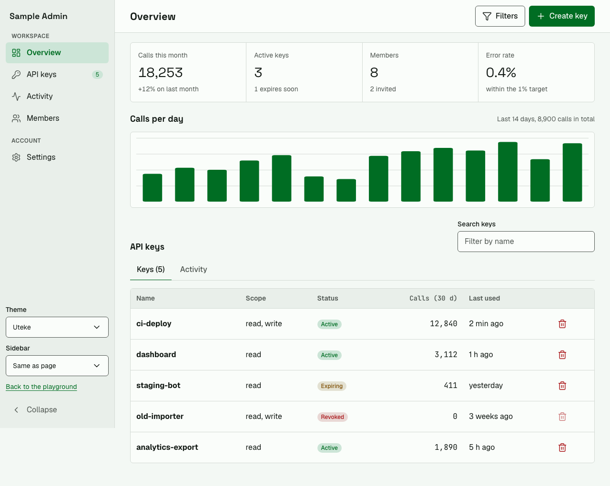 | 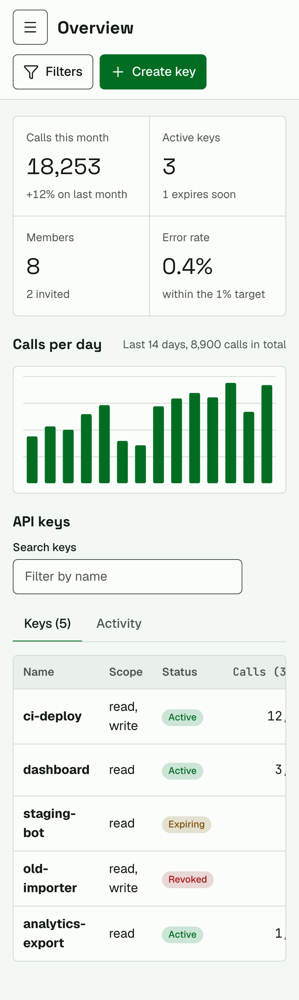 |

<details>
<summary>More screenshots</summary>

The Components page in three themes:

| Neutral | Uteke | Corin |
|---|---|---|
| 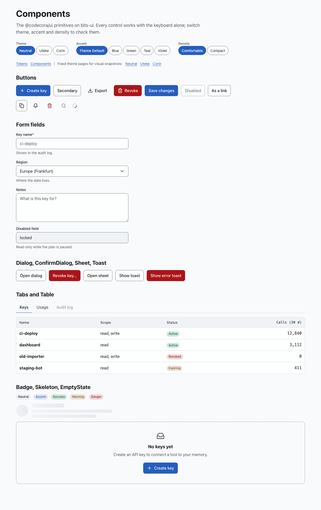 |  | 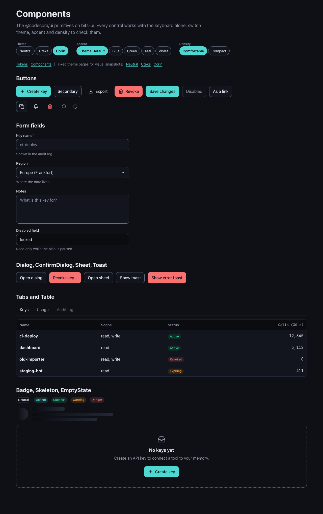 |

The admin dashboard sample in three themes:

| Neutral | Uteke | Corin |
|---|---|---|
| 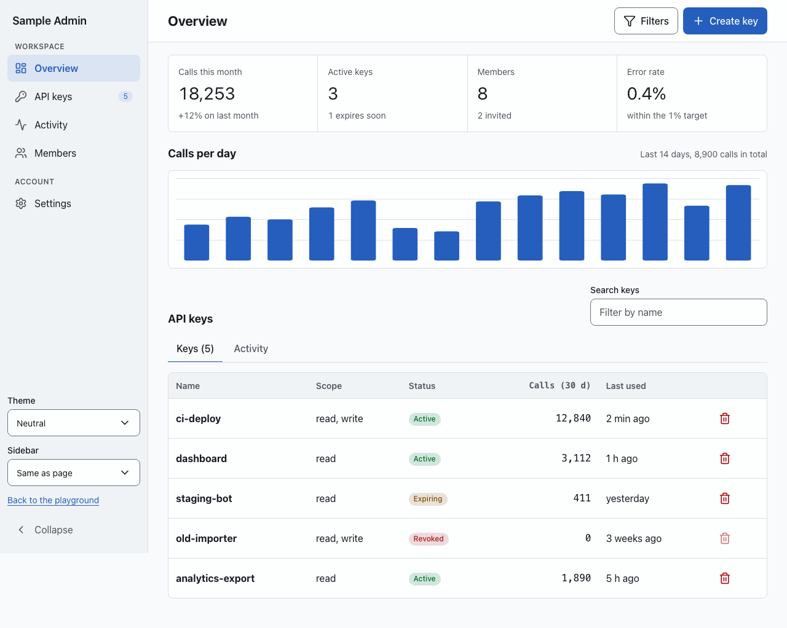 |  | 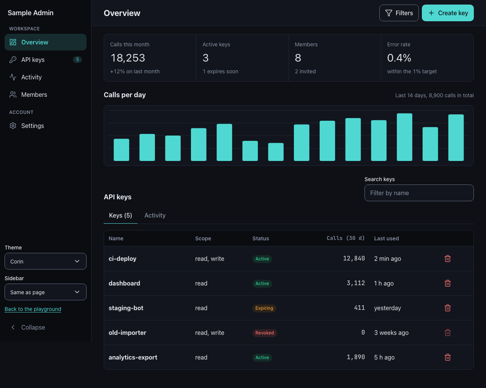 |

AppShell with a dark sidebar next to light content, and collapsed to icons:

| Dark sidebar | Collapsed |
|---|---|
| 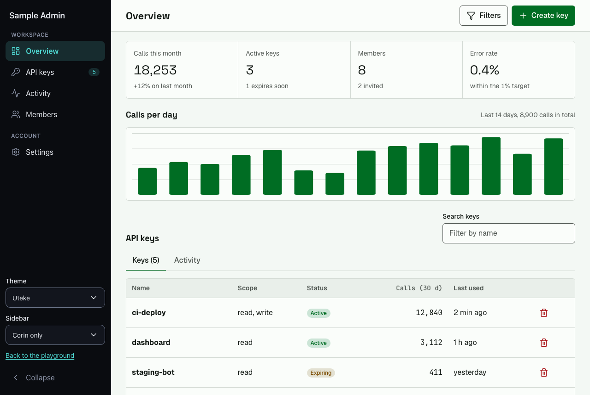 | 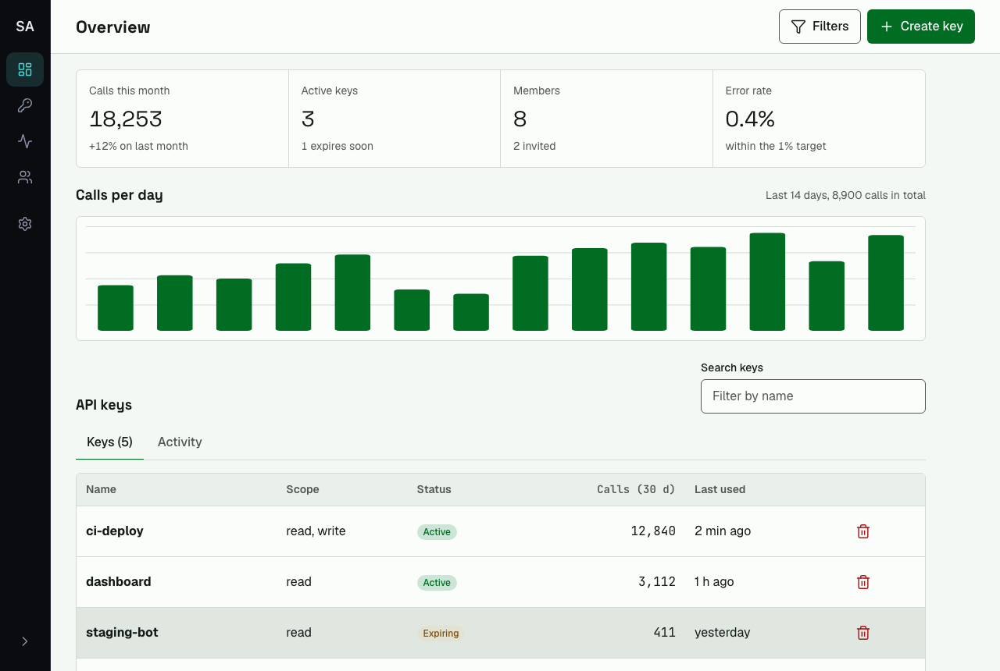 |

ConfirmDialog for an irreversible action:

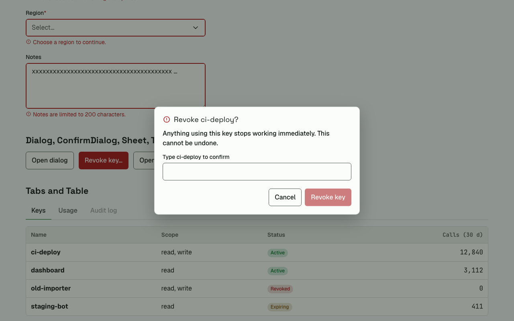

Icons follow each theme's size and stroke (neutral 2, uteke and corin 1.75):

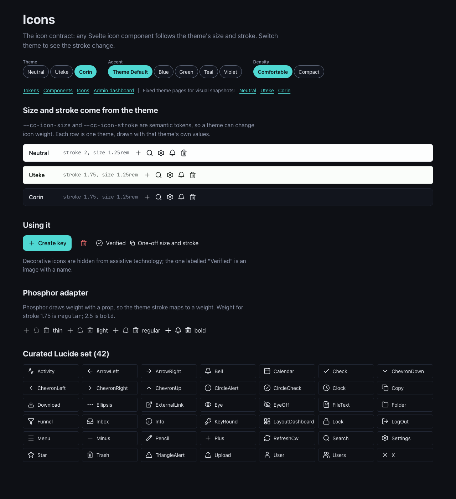

Brand marks and favicon sets, and the comparison that chose vector or PNG for each:

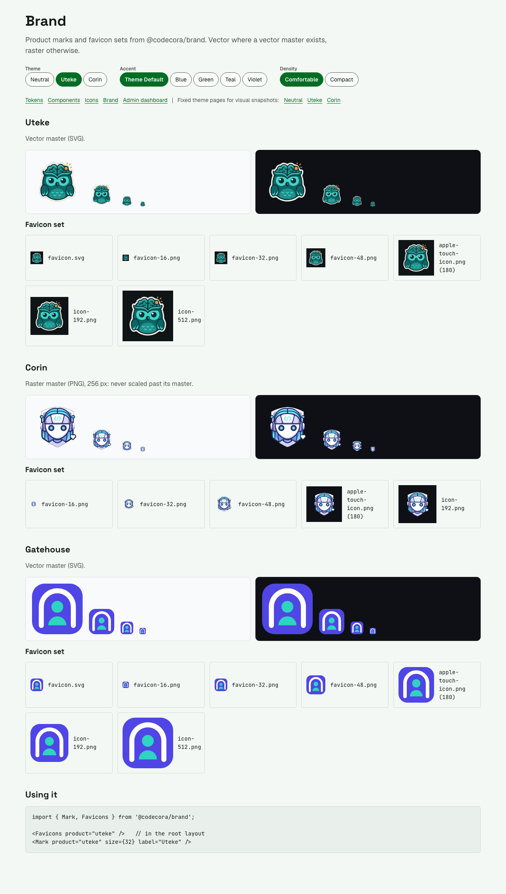

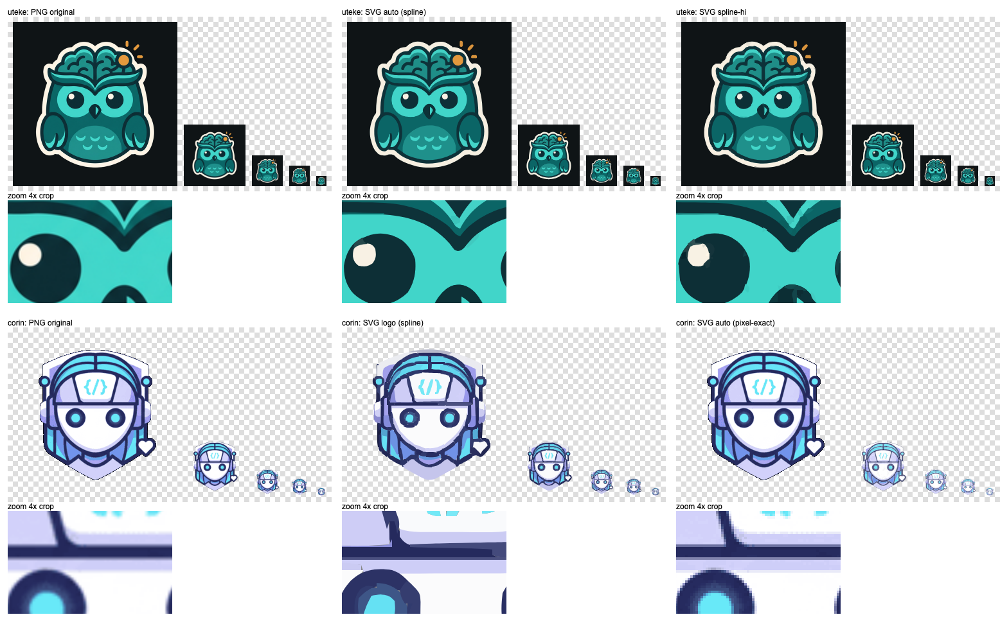

Navigation drawer at 375 px:

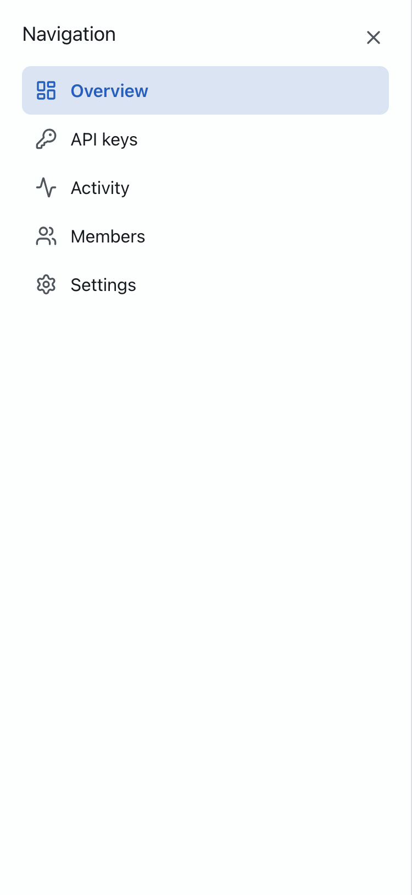

</details>

## Documentation

- [docs/architecture.md](docs/architecture.md): packages, tokens and how products consume them
- [docs/decisions.md](docs/decisions.md): locked decisions D1–D12
- [docs/roadmap.md](docs/roadmap.md): milestones M0–M4 and the issue map
- [DESIGN.md](DESIGN.md) and [docs/design/](docs/design): rules every theme shares, one file per theme
- [CHANGELOG.md](CHANGELOG.md)

## Contributing

Bug fixes are welcome. Changes to direction (new packages, decisions D1–D12)
start with an issue. See [CONTRIBUTING.md](CONTRIBUTING.md) and
[AGENTS.md](AGENTS.md) for the workflow and the local gates.

## Also from CodeCora

- [Uteke Cloud](https://uteke.app): long-term memory for Claude, ChatGPT and any
  MCP agent. Free plan, export any time.
- [Uteke](https://github.com/codecoradev/uteke): the open-source memory engine
  behind it, to run on your own machine.

## License

[Apache-2.0](LICENSE).
