# CodeCora UI

Shared design tokens, themes and Svelte 5 components for CodeCora products
(Uteke Cloud, Corin, and any other Svelte app in the fleet).

> Status: **planning (M0)**. Nothing is published yet. See
> [docs/architecture.md](docs/architecture.md) and
> [docs/decisions.md](docs/decisions.md).

## Packages (planned)

| Package | What | Depends on |
|---|---|---|
| `@codecora/tokens` | Primitive and semantic design tokens, themes (`neutral`, `uteke`, `corin`, more later), CSS variables, TS export, Tailwind 4 preset, shadcn variable bridge | nothing |
| `@codecora/ui` | Svelte 5 components on [bits-ui](https://bits-ui.com): Button, Field, Select, Dialog, Sheet, Tabs, Table, Badge, Toast, Tooltip, EmptyState, Skeleton, AppShell + Sidebar, CommandPalette. Plain CSS on semantic tokens, works with or without Tailwind | `@codecora/tokens`, `bits-ui` |
| `@codecora/icons` | Icon contract: an `Icon` wrapper that follows the `--cc-icon-*` tokens, a curated Lucide set (the default) and a Phosphor adapter | `@lucide/svelte`, `phosphor-svelte` (optional peers) |
| `@codecora/brand` | Product marks and favicon sets (Uteke, Corin, Gatehouse) as files and Svelte components | nothing |
| `@codecora/memory` | Uteke domain layer: types, `MemoryClient`, transports (Tauri, uteke-serve, Uteke Cloud), capabilities, memory browser components | `@codecora/ui` |

Plus a shadcn-svelte registry for blocks and templates that apps copy and
customise (login, settings, dashboard shell, data table), and
`apps/playground`, a SvelteKit catalogue of every component in every theme.

## Screenshots

The playground's Components page in each theme (`docs/assets/screenshots/`).

| Neutral | Uteke | Corin |
|---|---|---|
| 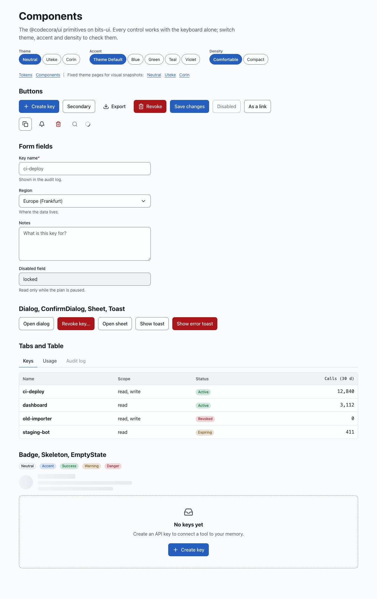 | 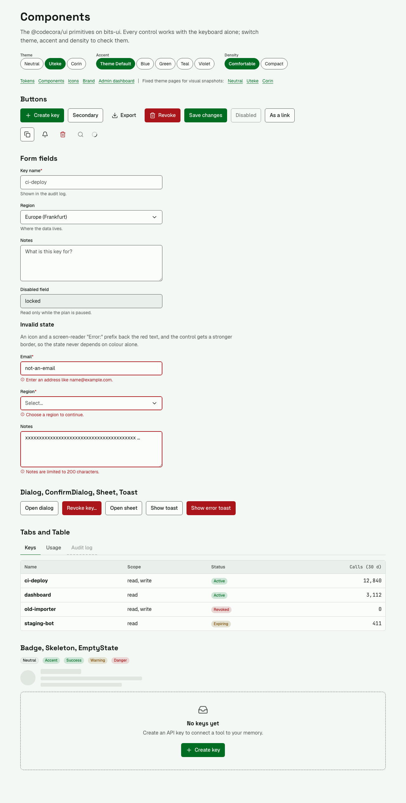 | 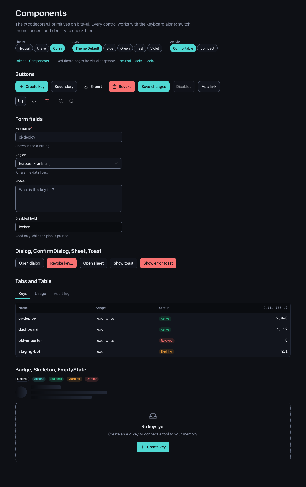 |

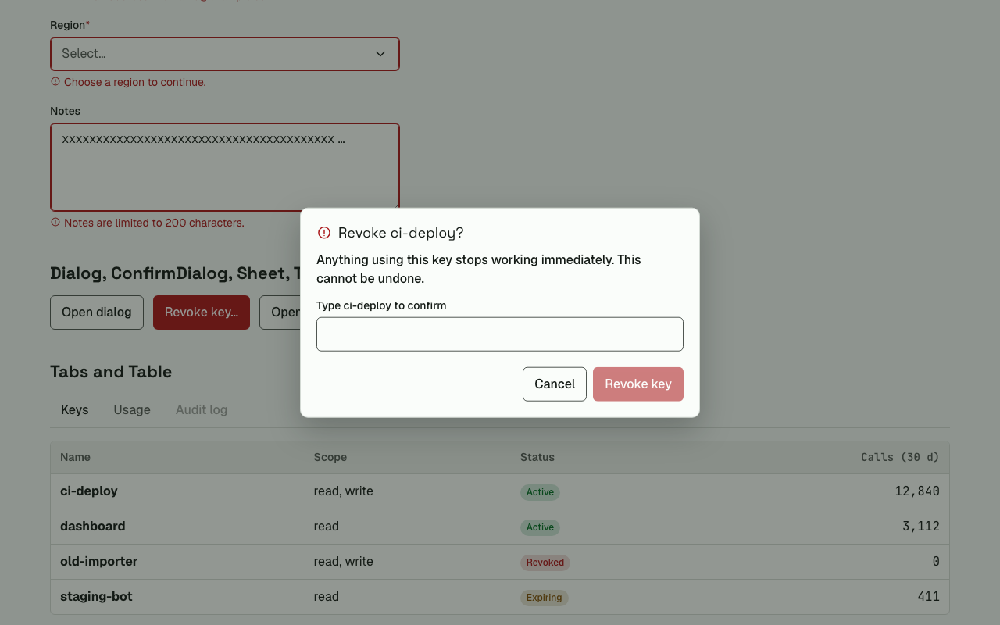

The admin dashboard sample (`/dashboard`), assembled from the primitives:

| Neutral | Uteke | Corin |
|---|---|---|
| 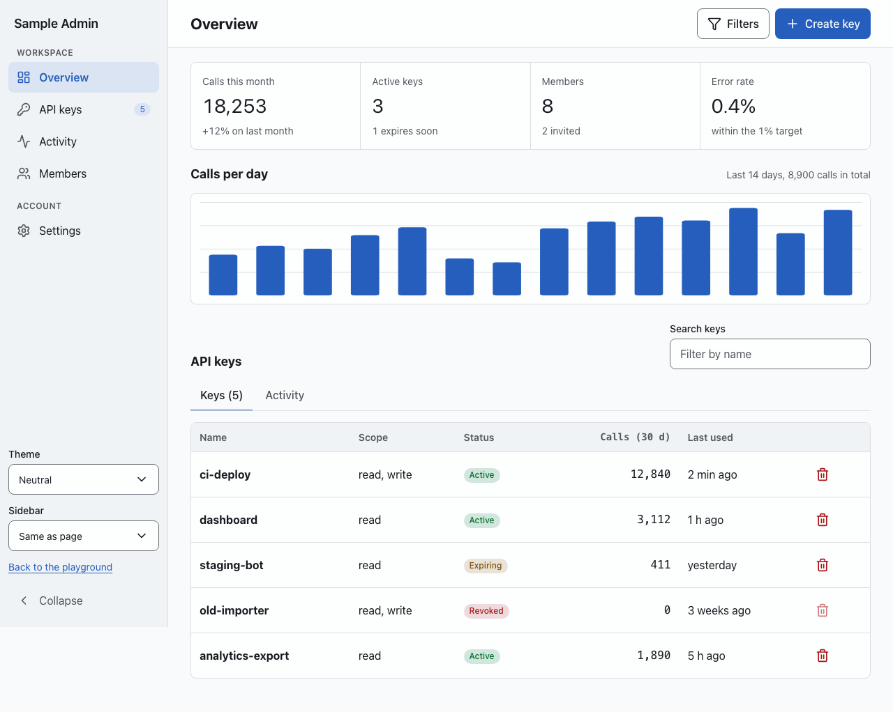 | 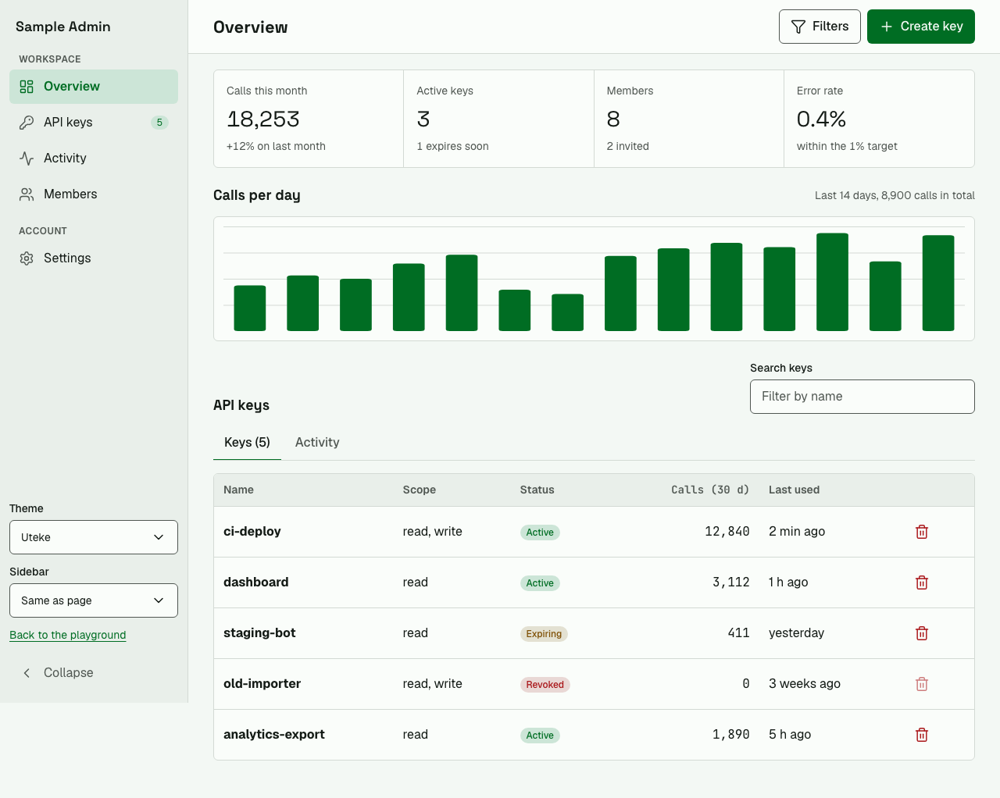 | 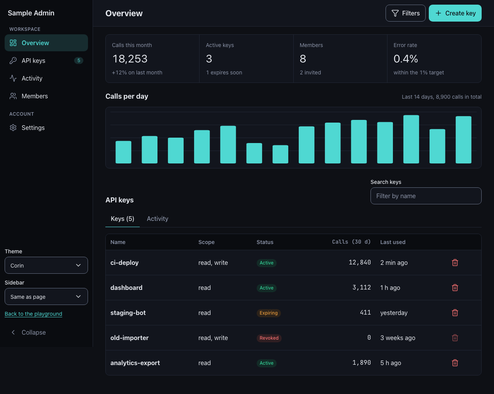 |

AppShell: a dark sidebar next to light content (a per-region theme), and the sidebar collapsed to icons:

| Dark sidebar | Collapsed |
|---|---|
| 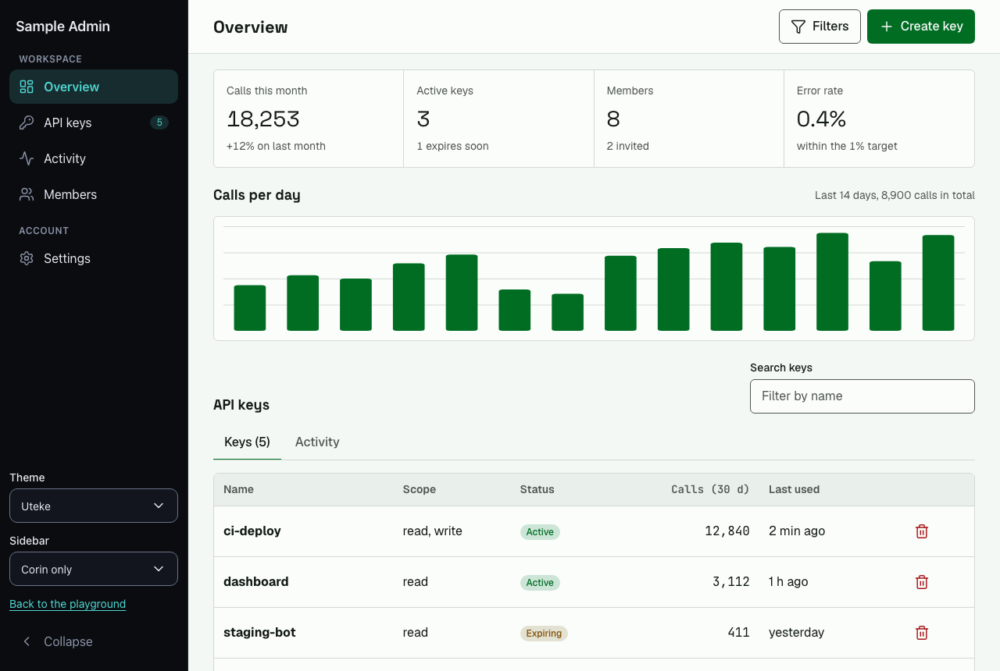 | 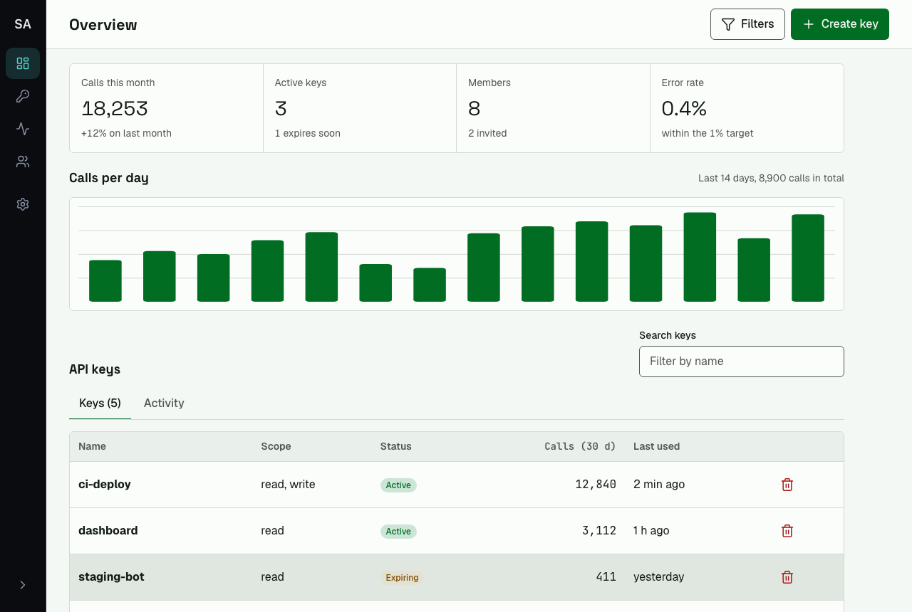 |

Icons: the contract follows each theme's own size and stroke (neutral 2, uteke and corin 1.75), with a curated Lucide set and a Phosphor adapter:

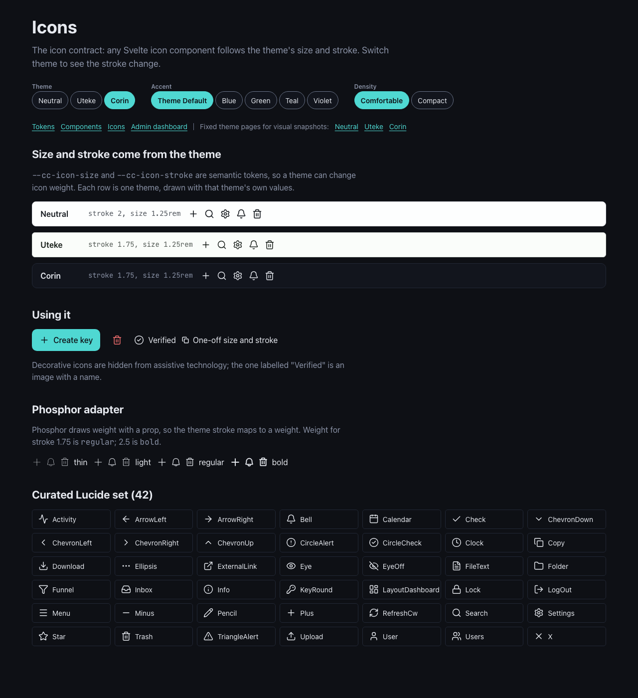

Brand: Uteke (vector), Corin (raster) and Gatehouse (vector) with their favicon sets, and the comparison that chose vector or PNG for each:

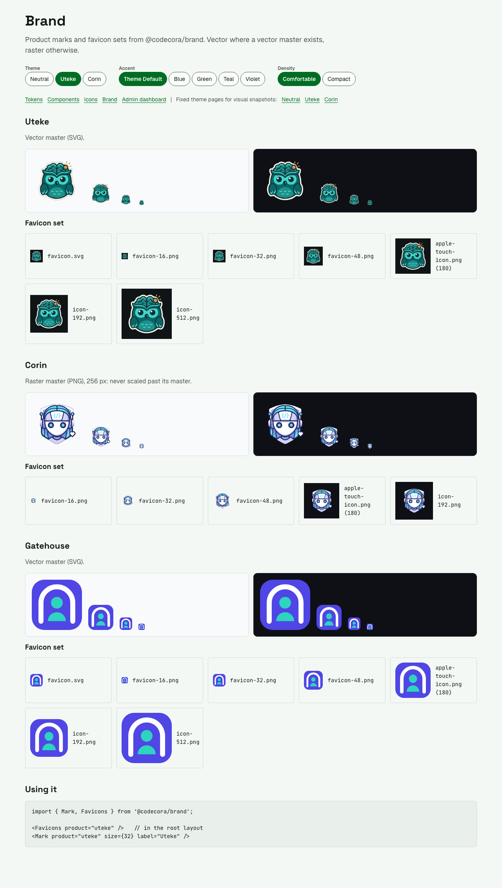

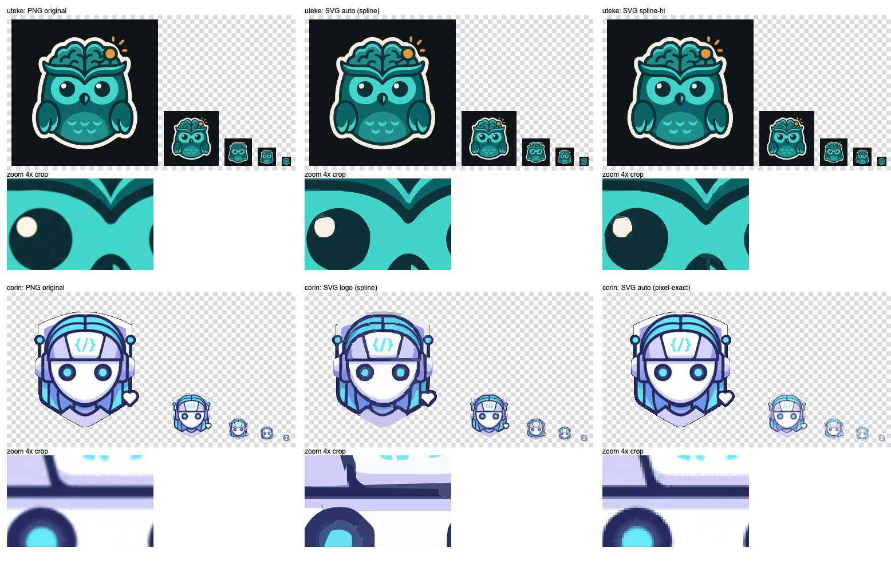

On a phone (375 px), with the navigation drawer open:

| Dashboard | Navigation |
|---|---|
| 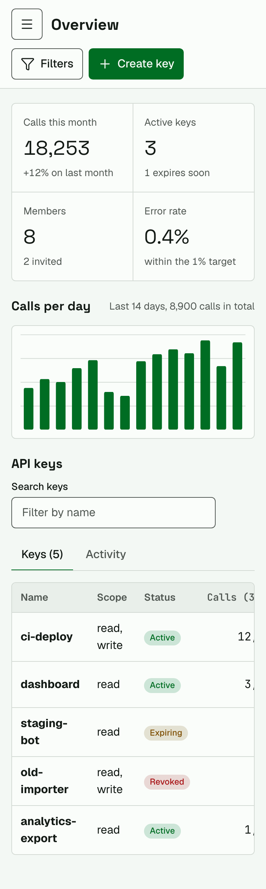 | 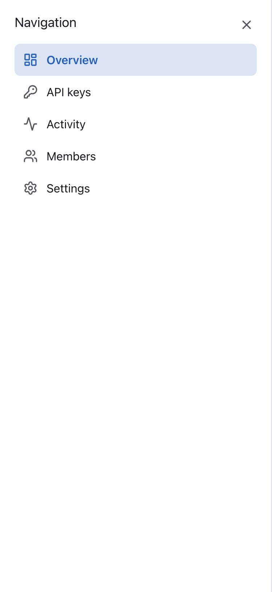 |

## Themes

Themes are sets of semantic token values applied with attributes on any
element, so they nest and mix:

```html
<body data-theme="uteke">
  <aside data-theme="corin">dark sidebar</aside>
  <main>editorial light content</main>
</body>
```

## License

[Apache-2.0](LICENSE).
